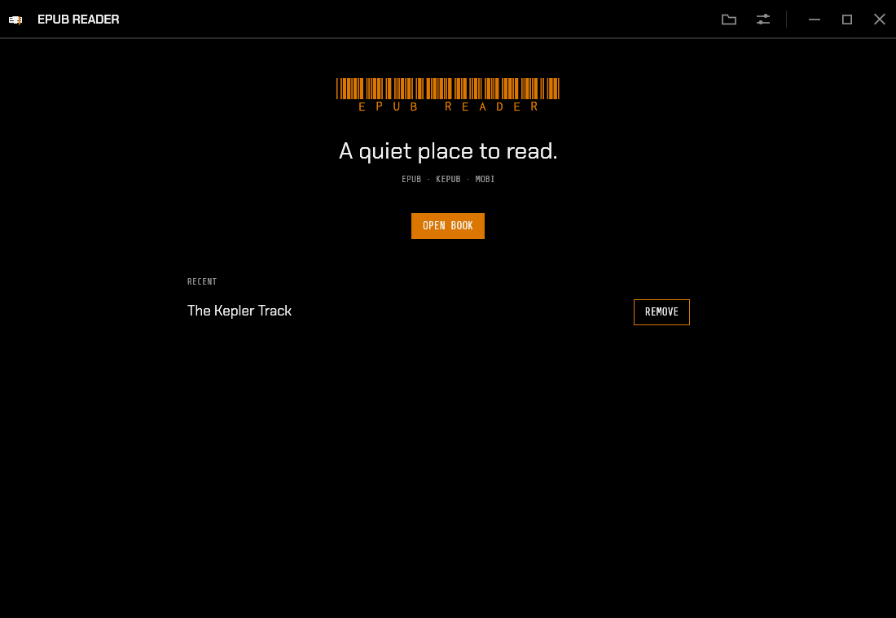

# epub-reader

A quiet, offline e-book reader for Windows, Linux and macOS, built in Rust with egui. One portable executable per platform — no installer, no accounts, no network access, no telemetry.

Reads **EPUB**, **KEPUB** (Kobo EPUB) and **MOBI**.

**[Download the latest release](../../releases/latest)**

## Screenshots

| Library | Reader |
| :---: | :---: |
| [](docs/img/library.png) | [](docs/img/reader.png) |
| Open a book from the file dialog, a drop, or the recent list. | A single calm column, with your place saved per book. |

| Contents | Settings |
| :---: | :---: |
| [](docs/img/contents.png) | [](docs/img/settings.png) |
| The contents sidebar shows the cover and chapter jumps. | UI scale, text size, line spacing and column width. |

## Features

- EPUB, KEPUB and MOBI
- Integrated title bar with window controls (native traffic lights on macOS)
- Compact contents sidebar with cover and chapter jumps
- Reading progress saved locally per book
- Settings for UI scale, text size, line spacing and column width
- Dark-only styling, with the NZ mark and font licences in Settings
- No console window on Windows

## Getting a build

Download the executable for your platform from the [latest release](../../releases/latest):

| Platform | File |
|---|---|
| Windows x64 | `epub-reader-windows-x64.exe` |
| Linux x64 | `epub-reader-linux-x64` |
| Linux arm64 | `epub-reader-linux-arm64` |
| macOS arm64 | `epub-reader-macos-arm64` |

No installer; run the file. The macOS build is unsigned, so the first launch may need Open from the context menu.

Or build locally:

```bash
cargo build --release
# target/release/epub-reader (or epub-reader.exe on Windows)
```

Supported targets: `x86_64-pc-windows-msvc`, `x86_64-unknown-linux-gnu`, `aarch64-unknown-linux-gnu`, `aarch64-apple-darwin`.

On Linux the binary needs the usual GUI libraries (X11 or Wayland, libGL); everything else is static.

## Privacy

The app never makes network requests. The only files it writes are a small JSON store for recent books and reading positions, in your platform config directory (`epub-reader/`).
